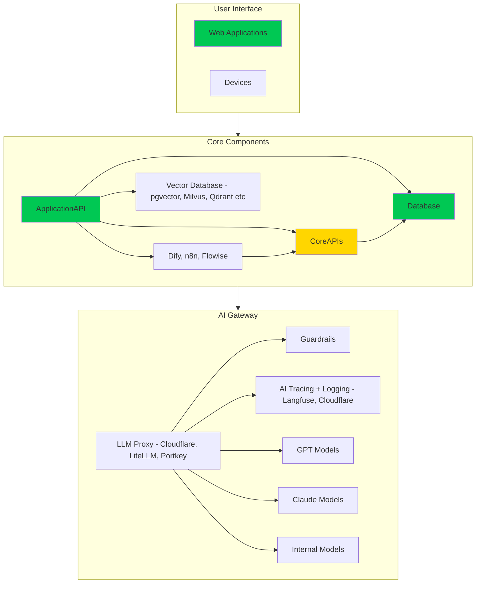
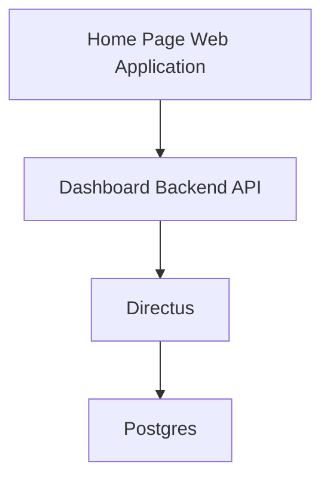
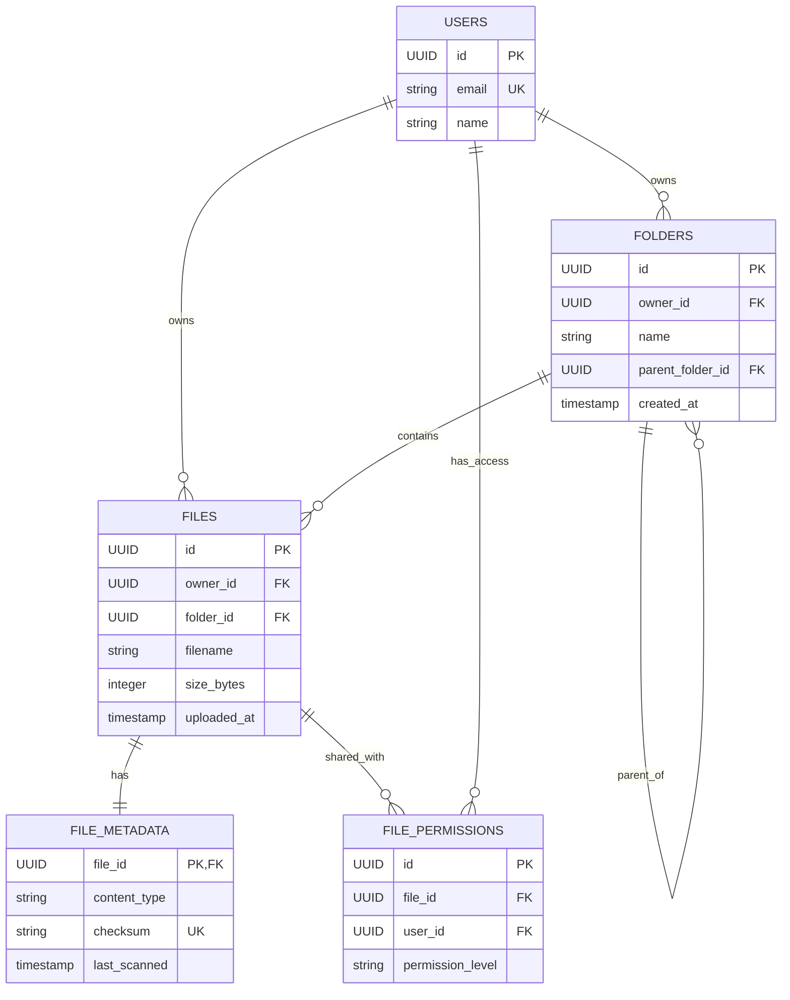
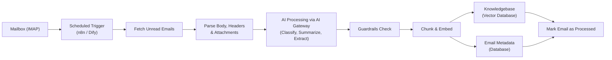
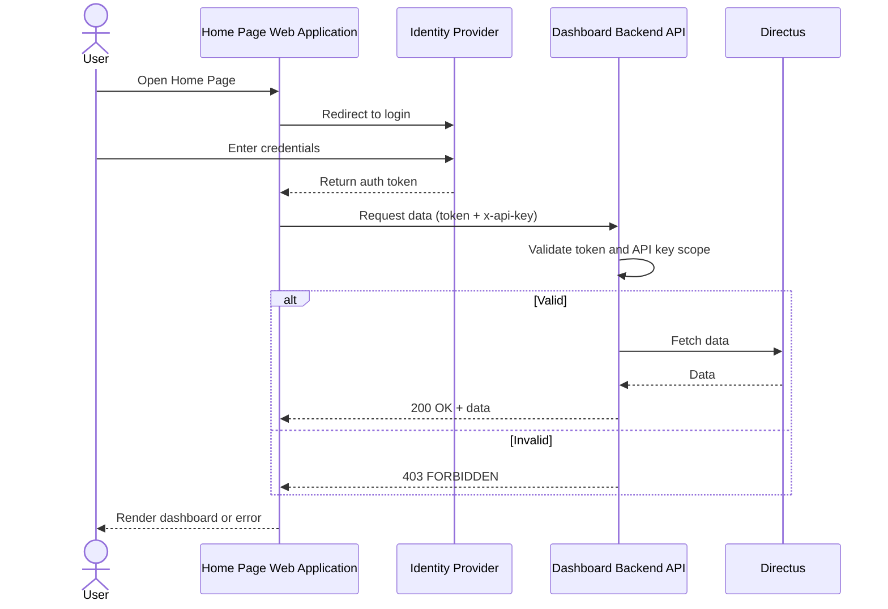
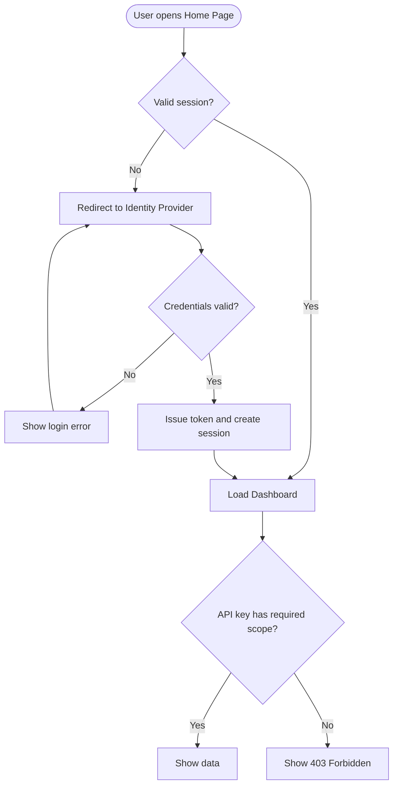
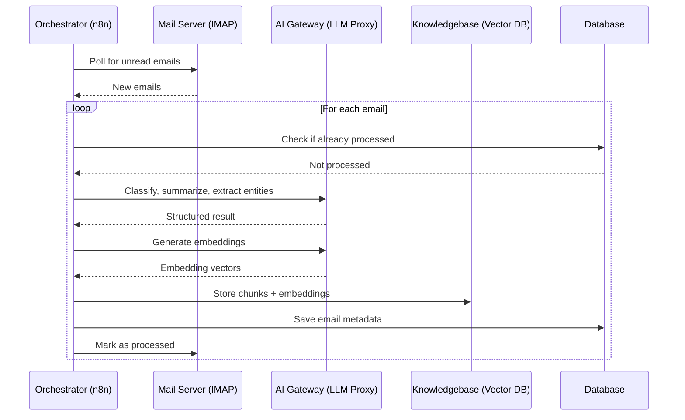
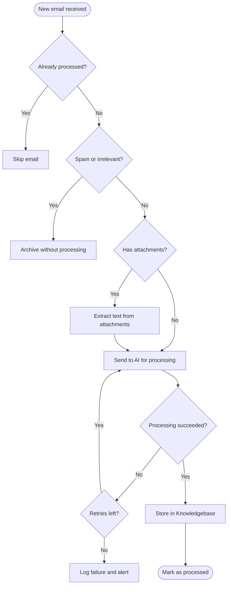

# ✅ HumanizeIQ Design Document (Template)

## 📝 How to Use This Template

**INSTRUCTIONS:**

1. **Make a copy** of this document for your component or project. Do not edit the template itself.
2. **Read the INSTRUCTIONS** at the start of each section before filling it in.
3. **Update each section** so it describes your component. The content in this template is sample content.
4. **Delete any section** that does not apply to your component.
5. **Remove the INSTRUCTIONS lines**, including this section, once your document is complete.

## 1️⃣ OFD

**INSTRUCTIONS:** Review the System Blueprint and identify your component's place in it by highlighting it in green, and the components you are using by highlighting them in yellow (OFD).



## 🧭 HLD

**INSTRUCTIONS:** Create your High Level Diagram for your Product and Project.



## 🧩 Component Design

**INSTRUCTIONS:** Add one sub-section for each component in your HLD. The components below are samples. Update them to match your components, or delete any that do not exist in your design.

### Home Page Application

**INSTRUCTIONS:** Update this section to describe your user interface component, or delete it if your component has no user interface.

#### Overview

The Home Page application will be the landing page for users.

#### Detailed Design

See Prototype at https://www.playtest.humanizeiq.ai/home/

---

### Dashboard Backend API

**INSTRUCTIONS:** Update this section with the API specification for your component, adding one specification per endpoint. Delete it if your component exposes no API.

#### 📘 API Specification – `GET /files`

##### 🔹 Overview

The `GET /files` endpoint retrieves a list of files and folders at a given path.

> **Used by**: UX via server-side functions
>
> **Reference**: [`dashboard-backend`](https://github.com/humanizeiq/dashboard-backend/blob/main/routes/files.ts)

##### 🔐 Authentication

| Item           | Value                          |
|----------------|--------------------------------|
| Method         | API Key via `x-api-key` header |
| Header Format  | `x-api-key: <YOUR_API_KEY>`    |
| Required Scope | `read:files`                   |

##### 🧭 Access URL

- Path: `/api/${APP_NAME}/files`

##### 🔧 Request Parameters

| Name | Type   | Required | Description                        |
|------|--------|----------|------------------------------------|
| path | string | ✅       | Absolute path (e.g., `/`, `/docs`) |

##### ✅ Example Request

```http
GET /api/${APP_NAME}/files?path=/documents/projectA
x-api-key: sk-demo-abc123xyz456
```

##### ✅ Success Response

```json
[
  {
    "name": "project-plan.pdf",
    "type": "file",
    "size": 204800,
    "lastModified": "2025-06-28T10:05:00Z"
  },
  {
    "name": "reports",
    "type": "folder"
  }
]
```

##### ❌ Error Response Format

```json
{
  "error": {
    "code": "FORBIDDEN",
    "message": "Your API key does not have access to this path."
  }
}
```

---

### 🗄️ Database Design

**INSTRUCTIONS:** Update the ER diagram, table definitions, and indexes to match your component's database. Delete this section if your component has no database.

#### 🔹 Overview

A separate database named `explorer` will be created for this product.

#### 🧩 Entity Relationship Diagram



#### 📋 Table Definitions

##### `users`

| Column | Type   | Constraints      | Description   |
|--------|--------|------------------|---------------|
| id     | UUID   | PK               | User ID       |
| email  | string | UNIQUE, NOT NULL | Email address |
| name   | string |                  | Display name  |

##### `folders`

| Column           | Type      | Constraints     | Description           |
|------------------|-----------|-----------------|-----------------------|
| id               | UUID      | PK              | Folder ID             |
| owner_id         | UUID      | FK → users.id   | Owner of the folder   |
| name             | string    | NOT NULL        | Folder name           |
| parent_folder_id | UUID      | FK → folders.id | For nesting folders   |
| created_at       | timestamp | DEFAULT now()   | Timestamp of creation |

##### `files`

| Column      | Type      | Constraints     | Description                   |
|-------------|-----------|-----------------|-------------------------------|
| id          | UUID      | PK              | File ID                       |
| owner_id    | UUID      | FK → users.id   | File owner                    |
| folder_id   | UUID      | FK → folders.id | Folder where the file resides |
| filename    | string    | NOT NULL        | Name of the file              |
| size_bytes  | integer   |                 | File size in bytes            |
| uploaded_at | timestamp | DEFAULT now()   | Upload timestamp              |

##### `file_metadata`

| Column       | Type      | Constraints       | Description               |
|--------------|-----------|-------------------|---------------------------|
| file_id      | UUID      | PK, FK → files.id | Links to file             |
| content_type | string    |                   | MIME type of file         |
| checksum     | string    | UNIQUE            | Hash for integrity checks |
| last_scanned | timestamp |                   | Timestamp of last scan    |

##### `file_permissions`

| Column           | Type   | Constraints   | Description                       |
|------------------|--------|---------------|-----------------------------------|
| id               | UUID   | PK            | Permission ID                     |
| file_id          | UUID   | FK → files.id | Target file                       |
| user_id          | UUID   | FK → users.id | User with access                  |
| permission_level | string | NOT NULL      | Example: `read`, `write`, `admin` |

#### 🔐 Indexes & Constraints

- `users.email` → UNIQUE
- `file_metadata.checksum` → UNIQUE
- Foreign key constraints with `ON DELETE CASCADE` where needed

---

### 📧 Email Processor Orchestration

**INSTRUCTIONS:** Update this section to describe your component's orchestration or workflow (for example n8n, Dify, or Flowise), or delete it if your component has no orchestration.

#### Overview

There will be an Email Processor orchestration that reads email using IMAP, processes it using AI, and puts it into the Knowledgebase.

#### Orchestration Flow



---

## 🔐 Roles & Permissions

**INSTRUCTIONS:** List every permission your app uses, then the roles that combine those permissions. Replace the sample `EX` (Explorer) entries with your own. Follow these rules:

- Every view and action in the app must be coded to a unique permission named `APP_PREFIX_PERMISSION` (for example `EX_VIEW`).
- Each app must define at least one role, `APP_PREFIX_ADMIN`, which includes **all** of the app's permissions.
- Add more roles as user requirements need them.
- Register every role in the App Role Template so the app can be enabled per company or BU through the App Registry.

### Permissions

| Permission         | Description                                         |
|--------------------|-----------------------------------------------------|
| `EX_VIEW`          | View the app and browse files and folders           |
| `EX_FILE_DOWNLOAD` | Download files                                      |
| `EX_FILE_UPLOAD`   | Upload new files                                    |
| `EX_FILE_DELETE`   | Delete files                                        |
| `EX_FOLDER_CREATE` | Create folders                                      |
| `EX_FOLDER_DELETE` | Delete folders                                      |
| `EX_SHARE`         | Share files with other users and set access levels  |
| `EX_SETTINGS`      | Manage app settings                                 |

### Roles

| Role        | Description                                    | Permissions                                                                                                                    |
|-------------|------------------------------------------------|--------------------------------------------------------------------------------------------------------------------------------|
| `EX_ADMIN`  | Full access to the app (**required**)          | All permissions                                                                                                                |
| `EX_VIEW`   | Read-only access                               | `EX_VIEW`, `EX_FILE_DOWNLOAD`                                                                                                  |
| `EX_EDITOR` | Manage content without changing app settings   | `EX_VIEW`, `EX_FILE_DOWNLOAD`, `EX_FILE_UPLOAD`, `EX_FILE_DELETE`, `EX_FOLDER_CREATE`, `EX_FOLDER_DELETE`, `EX_SHARE`           |

### Role–Permission Matrix

| Permission         | `EX_ADMIN` | `EX_VIEW` | `EX_EDITOR` |
|--------------------|:----------:|:---------:|:-----------:|
| `EX_VIEW`          | ✅         | ✅        | ✅          |
| `EX_FILE_DOWNLOAD` | ✅         | ✅        | ✅          |
| `EX_FILE_UPLOAD`   | ✅         |           | ✅          |
| `EX_FILE_DELETE`   | ✅         |           | ✅          |
| `EX_FOLDER_CREATE` | ✅         |           | ✅          |
| `EX_FOLDER_DELETE` | ✅         |           | ✅          |
| `EX_SHARE`         | ✅         |           | ✅          |
| `EX_SETTINGS`      | ✅         |           |             |

---

## 🔀 Logical Flows

**INSTRUCTIONS:** Add a sequence diagram and a logic flow for each key flow in your component. The flows below are samples. Update them to match your component, or delete any that do not apply.

### User Authentication Flow

**INSTRUCTIONS:** Update this flow to show how users authenticate with your component, or delete it if your component has no user authentication.

#### Sample Sequence Diagram



#### Sample Logic Flow



### Email Processing Flow

**INSTRUCTIONS:** Update this flow to show your component's processing logic, or delete it if your component does not process email.

#### Sample Sequence Diagram



#### Sample Logic Flow


